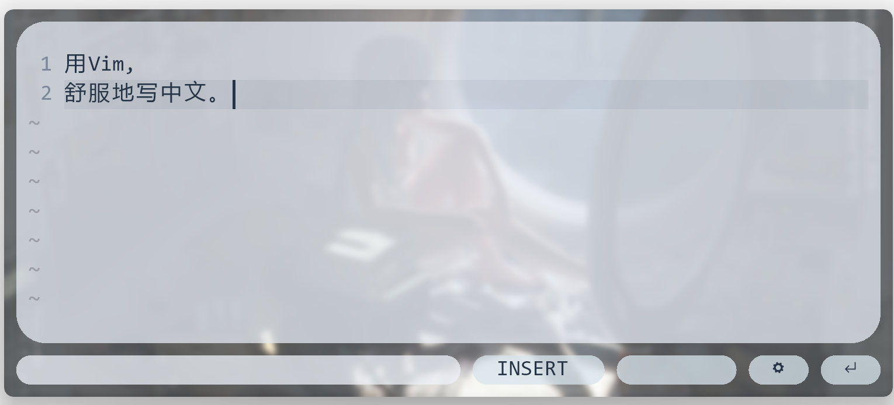
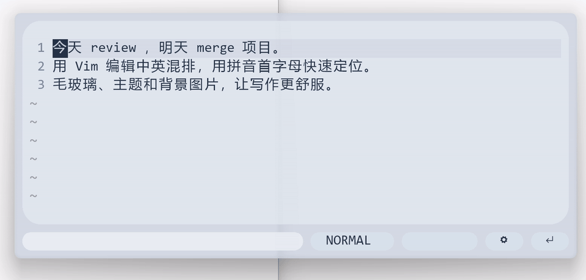
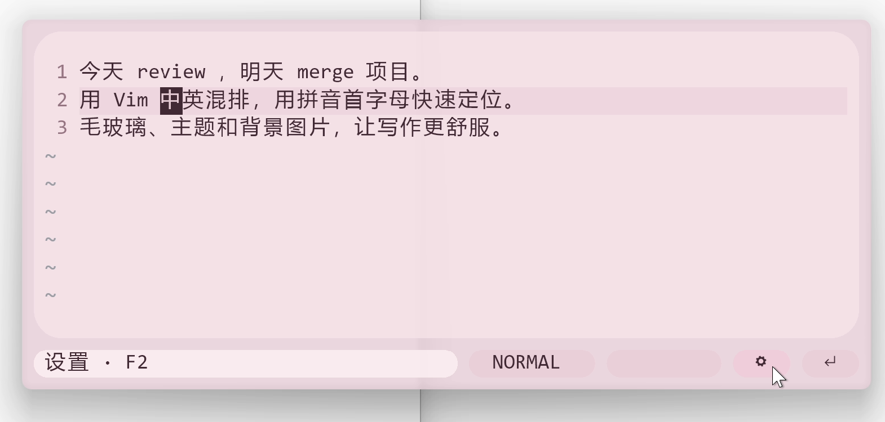
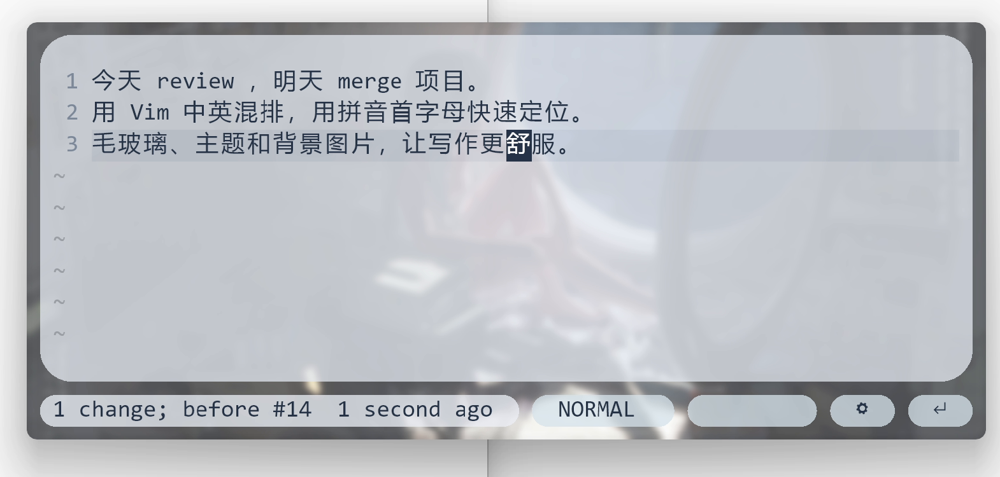

<p align="center">
  
</p>

<h1 align="center">PinyinVim · 拼音浮笺</h1>

<p align="center">A floating Vim editor for writing in Chinese.</p>
<p align="center"><strong>English</strong> · <a href="README.zh-CN.md">简体中文</a></p>

Write in a focused floating window, edit with real Neovim, then return your text to the application you were using. PinyinVim combines familiar Vim editing with local Chinese navigation, a frosted-glass interface, and customizable themes.

<p align="center">
  <a href="https://github.com/Echo-Long/PinyinVim/releases/latest"><strong>Download the latest release</strong></a> · <a href="#getting-started">Quick start</a> · <a href="#demo">Watch the demo</a>
</p>

<p align="center">
  
</p>
<p align="center"><em>Actual application screenshot with a custom background image.</em></p>

> **Released for Windows x64.** The application interface is in Simplified Chinese. The product version is defined in [package.json](package.json).

[Demo](#demo) · [Quick start](#getting-started) · [Chinese navigation](#chinese-navigation) · [Vim basics](#vim-basics) · [Appearance](#customize-the-interface) · [Notifications](#control-system-notifications) · [Compatibility](#submitting-text-and-compatibility)

## Features

- **Real Vim editing.** Normal, Insert and Visual modes, operators, registers, macros, undo and repeat are handled by Neovim.
- **Chinese and English navigation.** Character searches still match literal letters; lowercase letters additionally match Chinese pinyin initials. Chinese word navigation extends familiar motions and text objects.
- **A draft close at hand.** Open the editor with a global shortcut, hide it when you are done, and resume your automatically saved draft later.
- **A customizable interface.** Ten color themes, light or dark mode, background images, adjustable blur, and separate transparency for the window background and capsule panels.
- **Mode-aware input methods.** Remember the input-method state used in Insert, use English in Normal and Visual, and restore the previous state on returning to Insert. This policy can be disabled.
- **Copy or return your text.** Attempt one paste into a confirmed original input field, or keep the text in the clipboard for manual pasting. Copy notifications can be turned on or off.

Chinese navigation is processed locally. PinyinVim does not call AI services or upload your draft while you edit.

## Demo



[Download and play the full demo (MP4, 1 min 37.5 s)](docs/media/demo.mp4?raw=true)

The short preview shows navigation in mixed Chinese and English text. The full recording also demonstrates Vim editing and undo, themes, background images, appearance settings, and submitting text back to Notepad. All images and recordings show the real application with the recording user's settings.

## Getting started

Download the Windows x64 portable archive from the [latest release](https://github.com/Echo-Long/PinyinVim/releases/latest). Extract the **entire folder** into a writable location, then open `PinyinVim.exe`. Neovim, Neovide, dictionaries and a fallback font are bundled; Node.js, Python and a separate Vim installation are not needed to run it.

System requirements include .NET Framework 4.8, Microsoft Visual C++ v14 x64 runtime and a working graphics driver. If startup reports a missing `VCRUNTIME140.dll`, see the [portable guide](docs/portable-readme.md) and Microsoft's [official runtime download](https://learn.microsoft.com/en-us/cpp/windows/latest-supported-vc-redist?view=msvc-170). Source code is available in this repository; see [build and test](#build-and-test).

### Your first draft

1. Place the caret in the application where you want to write, then press `Ctrl+Shift+X`.
2. Press `i` to enter Insert mode and write. Press `Esc` to return to Normal mode, where you can navigate and edit with Vim commands.
3. Press `Ctrl+Enter` to submit. In compatible input fields, PinyinVim attempts to paste back once. In clipboard-only cases, return to the desired field and press `Ctrl+V` yourself.

To keep writing later, press `Esc` in Normal mode to hide the window. Use `F2` for settings; changes are saved and applied automatically.

Submission starts when you press `Ctrl+Enter` and hides the editor immediately. Holding the keys down still submits only once.

### Default shortcuts

| Shortcut | Action |
| --- | --- |
| `Ctrl+Shift+X` | Show or hide the floating editor. |
| `i` | Enter Insert mode from Normal mode and start typing. |
| `Esc` | Leave Insert/Visual or cancel the command line with normal Vim behavior; press again in Normal mode to hide the window. |
| `Ctrl+Enter` | Submit the draft: attempt a paste into the original input field, or copy for manual pasting. |
| `F2` | Open settings. |
| `Ctrl+C` | Copy the draft in Normal/Insert, or the selection in Visual. |
| `Ctrl+V` | Paste from the clipboard in Insert mode. |
| `Ctrl+mouse wheel` | Adjust the editor font size. |

Application shortcuts can be changed in settings and take precedence over their original Vim bindings in the modes where they apply. Closing the window, `Alt+F4` and minimizing also hide it. Use **Exit** in the system tray menu to quit the application.

## Chinese navigation

Enable **Pinyin initial navigation** (`拼音首字母定位`) and **Chinese word navigation** (`中文分词导览`) under `F2 → 编辑与草稿`. The two switches are independent.

### Try mixed Chinese and English text

Paste this line into a draft, press `Esc` to enter Normal mode, then try the commands below. Each command starts with `0` to return to the beginning of the line.

`0` is Vim's “first character of the current line” motion, including any leading spaces. For example, `0fr` means press `0`, then `f`, then `r`; `02fm` means return to the line start, then find the second `m` match with `2fm`.

```text
今天 review 中文，明天 merge 项目。
```

| Type | What happens |
| --- | --- |
| `0fr` | Jump to the literal English `r` in `review`. |
| `0fz` | Jump to `中`, whose pinyin starts with `z`. |
| `0fm` | Jump to `明`, the first `m`/pinyin-`m` match ahead. |
| `02fm` | Jump to the English `m` in `merge`, the second match. English and Chinese matches share the same count. |

The search is confined to the current line. Lowercase Latin targets match both literal letters and Chinese pinyin initials; uppercase targets retain literal matching. After a search, `;` repeats in the same direction and `,` repeats in the opposite direction.

### Familiar motions, with Chinese words

| Editing action | How to use it |
| --- | --- |
| `f` / `F` | Find a character forward/backward on the current line. |
| `t` / `T` | Stop just before/after the corresponding match. Useful with operators such as `d` or `c`. |
| `w` / `b` | Move to the next/previous word boundary, including Chinese words. |
| `e` / `ge` | Move to the end of the next/current word or the previous word. |
| `ciw` | With the caret on a word, change that word and enter Insert mode. |
| `diw` / `daw` | Delete the inner word or the word with its surrounding spacing. |
| `viw` | Select the current word in Visual mode. |
| `3w` | Move by three word motions. Counts also work with character searches and operators. |

For instance, move onto `项目` in the example and type `ciw` to replace that word. Chinese boundaries come from the included local dictionary; punctuation forms a separate boundary. Turning the two Chinese switches off returns the corresponding motions to native behavior.

The document, undo and command model remain Neovim's existing implementation. English-only regression tests compare supported motions and operators against native Neovim.

## Vim basics

If you are new to Vim, start with this small set. Type Normal-mode commands after pressing `Esc`.

| Goal | Keys |
| --- | --- |
| Start typing / return to Normal | `i` / `Esc` |
| Move left, down, up, right | `h`, `j`, `k`, `l` |
| Go to the start / end of the line | `0` / `$` |
| Select text | `v`, then move; `V` selects whole lines. |
| Copy a line / paste the Vim register | `yy` / `p` |
| Delete a line | `dd` |
| Undo / redo | `u` / `Ctrl+R` |
| Repeat the last change | `.` |
| Search text / next match | `/text`, `Enter` / `n` |

Use `Ctrl+C` for the Windows clipboard; `yy` and `p` use Vim registers. App shortcuts override their original Vim bindings only in the modes where they apply.

## Customize the interface

Open `F2 → 外观`. Changes apply immediately and are saved automatically.

<p align="center">
  
  
</p>
<p align="center"><em>Rose theme and custom background image, captured from the demo.</em></p>

See the [appearance settings screenshot](docs/media/settings-appearance.png) for the controls below. Screenshots show custom settings; the default values are listed after the table.

| Setting | How to use it |
| --- | --- |
| **Theme color** (`主题色`) | Pick one of ten palettes: Mist Blue, Lemon, Lavender, Mint, Peach, Rose, Sky, Sand, Forest or Graphite. This changes the shell and capsule colors. |
| **Dark theme** (`深色主题`) | Switch the editor between light and dark color schemes. |
| **Frosted glass** (`背景模糊`) | Enable the frosted backdrop, then adjust `高斯模糊` for the amount of blur. |
| **Background transparency** (`背景透明度`) | Control how much the window background shows through. `0%` is opaque; `100%` is fully transparent. |
| **Capsule transparency** (`胶囊透明度`) | Adjust the editor, message area and small capsule panels separately from the outer background. |
| **Background image** (`背景图片`) | Click `选择` and choose a local image. It fills the window and follows background transparency; `清除` removes it. PNG/JPG are good starting formats; the picker also accepts WEBP. An unreadable image falls back to the normal background. |
| **Font size** (`编辑字号`) | Change it here, or use `Ctrl+mouse wheel` in the editor. |

For a first glass setup, try the defaults: Mist Blue, glass enabled, background transparency `50%`, capsule transparency `20%`, and blur `5 px`. For a background image, lower background transparency if the picture is too faint. Lower capsule transparency if you want more solid panels behind the text; text opacity is kept separate. `恢复默认外观` resets appearance settings.

Move the window by dragging an empty area of its outer shell; resize it from the edges or corners.

## Control system notifications

Under `F2 → 编辑与草稿`, turn **System notifications** (`系统通知`) on or off. It is **off by default**, takes effect immediately and is remembered after restarting. An existing saved choice is preserved when upgrading.

When on, successful copies and non-empty submissions request a system notification showing the result; startup status may also notify you. When off, these system notifications are suppressed. Clipboard copying, paste attempts and automatic draft saving still work, and in-editor feedback remains visible.

Windows notification settings may also prevent notifications from appearing.

## Submitting text and compatibility

We have tested PinyinVim across many Windows applications. Open it from the field where you want to write, then submit your draft. When the original field can be identified and verified, the app restores focus and sends **one** paste attempt. The submit button's hover text indicates whether the current route is paste-back or clipboard-only.

### Known clipboard-only cases

| Application / entry point | How to use it |
| --- | --- |
| **Windows taskbar search** | Submit to copy the text, reopen the search field if needed, and paste with `Ctrl+V`. |
| **WeChat** | Submit to copy the text, switch back to the chat input field, and paste with `Ctrl+V`. |

Automatic paste-back is currently unavailable in these two known cases. Clipboard copying still works. Microsoft To Do's original-field focus problem has been fixed and confirmed in testing. Results can vary with application versions, privileges and input controls; if another field cannot be confirmed, the same clipboard fallback is used.

Every successful non-empty submission puts the text in the clipboard. **If system notifications are enabled**, the notification describes whether a paste was sent or manual pasting is needed. “Paste sent” confirms shortcut dispatch, not acceptance by the receiving application.

PinyinVim does not send `Enter` to the target application, automatically send chat messages, or retry pasting. Submitted text remains in the clipboard; restoring the previous clipboard contents is not implemented. See [compatibility and known limitations](docs/compatibility.md).

## Drafts, settings and privacy

Drafts and settings are stored in `prototype-profile`, created next to the application on first launch. Drafts are saved automatically while you edit. Hiding the editor preserves them; **clear draft on exit** applies only when you quit from the system tray. If disabled, quitting also preserves the draft. After a paste is sent successfully, the next invocation prepares a fresh draft; the previous submission is kept in `prototype-profile/last-submitted.txt` for recovery. Clipboard-only submissions and failures preserve the current draft.

Before upgrading, save any text you need, quit the old instance and use a separate folder for the new build. See the [portable guide](docs/portable-readme.md) for migration details. Draft and settings files may contain personal information; keep them out of public commits and bug reports.

Input-field detection checks focus, control capabilities and window/process identity without reading the target application's text. Integration diagnostics record process names, control types and outcomes rather than draft contents.

## Build and test

Use Windows x64 with Windows PowerShell 5.1 or PowerShell 7, the .NET Framework compiler and MinGW-w64 `gcc` available on `PATH`. See the [build guide](docs/build.md) for setup and runtime verification.

```powershell
# Download and verify the pinned Neovim and Neovide runtimes.
.\native\setup-runtime.ps1

# Build the application, then run automated checks.
.\native\build.ps1
.\native\test.ps1

# Open an existing build.
.\native\start.ps1
```

If Node.js is installed, `npm run build`, `npm test` and `npm start` provide the corresponding commands. Ordinary builds use the included dictionaries and do not require installing npm dependencies. Node.js 20+ and `npm ci` are needed when regenerating dictionary data with `npm run data:regenerate`.

The build derives application metadata from `package.json`; pinned runtime versions and checksums are in [native/runtime-assets.json](native/runtime-assets.json). Automated checks cover native Vim equivalence, Chinese navigation, draft persistence, submission, focus policies and settings contracts. They do not replace desktop testing of real input methods, DPI scaling, graphics or receiving applications.

## Project structure and next steps

| Location | Purpose |
| --- | --- |
| `native/nvim` | Neovim configuration, Chinese navigation and draft/host bridge. |
| `native/host` | Windows lifecycle, focus, clipboard, input methods and submission policies. |
| `native/prototypes/capsules` | Current capsule interface, window effects and settings; retained directory name from development. |
| `native/tests` | Automated regression and integration contracts. |
| `assets/branding` | Application icon and branding assets. |
| `docs/media` | Actual interface screenshots, the short preview and the full demo video. |
| `docs` | Build instructions, compatibility, roadmap, changelog and third-party notices. |

The [roadmap](docs/roadmap.md) prioritizes application compatibility, real input-method testing and multi-monitor DPI checks. Published downloads are available in [Releases](https://github.com/Echo-Long/PinyinVim/releases); the [release workflow](docs/release-plan.md) documents packaging, verification and publication.

See the [changelog](docs/CHANGELOG.md) for version updates and [third-party notices](docs/THIRD_PARTY_NOTICES.md) for component licenses and attribution.

## Help and contributions

Use the repository's Issues page to report bugs or request features. Include your product version, Windows version, the affected application/version, steps to reproduce, and what you expected versus what happened. Please omit private drafts, clipboard text and settings containing personal paths.

Contributions should preserve the existing Neovim/Neovide architecture and extend it through the current layers. Include reproduction steps and relevant checks for behavior changes; see the [build guide](docs/build.md) and [roadmap](docs/roadmap.md).

## License

Project source is licensed under [MIT](LICENSE). Third-party components, dictionaries, fonts and interface icons retain their own licenses; see [third-party notices](docs/THIRD_PARTY_NOTICES.md). Neovim and Neovide remain the editor and rendering foundations of this project.
